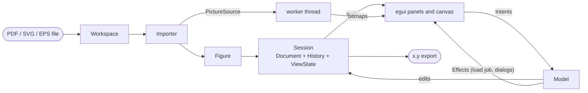
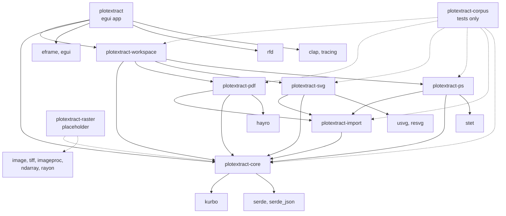

# plotextract

Get the numbers out of a plot. Open a figure that was drawn as vectors (PDF, SVG, EPS or PostScript), tell the app what
two ticks on each axis are worth, click the curves you want, and export their points as `x,y` in the plot's own units.


plotextract does not trace pixels. It reads the paths the figure was drawn with, so every point it exports is a vertex
of the original curve, converted through your calibration. On the matplotlib and Mathematica figures in the test suite
the recovered series are within 0.1% of the plot's extent (matplotlib's are exact to the printed precision).

## What it does

1. **Open** a file: File > Open, drag it onto the window, or `plotextract plot.pdf`. Opening happens in the background:
   the window stays usable while a big file loads. A document with several pages opens at page 1; the **Page** control at
   the top of the side panel (or Page Up and Page Down) moves between pages, and work on a page is waiting when you come
   back to it. A PDF that needs a password asks for it.
2. **Calibrate.** Ctrl+click the end point of a tick mark (the pointer snaps to path vertices), right-click and record it
   as *x min*, *x max*, *y min* or *y max*, then type the value that tick stands for (`0.001` and `1e-3` both work). Two
   ticks per axis; tick *x log* or *y log* for logarithmic axes.
3. **Select.** Ctrl+click a curve to select it; Ctrl+Shift+click adds or removes it in the active **series**. A series can
   be any number of curves: one stroke, a dashed line drawn as many pieces, a set of markers.
4. **Export.** *Export CSV* or *Copy numbers* write the active series as `x,y` rows, optionally sorted by x.

| Tool | |
|---|---|
| Hand (default) | drag pans, the wheel zooms about the cursor, Ctrl+0 fits the page |
| Select (hold Ctrl; Cmd on macOS) | the pointer snaps to the nearest vertex, a click selects the curve and the point |
| Right click | records the selected point as a calibration tick |

The side panel has a card for each step: *Calibration* (the four ticks, their positions and values, log axes, a
**Record** button for Ctrl+R; a green dot beside its title and green outlines on an axis's value boxes show that the
axis is calibrated, and hovering the dot says what is missing), *Series*, *Curves* and *Selection*. The Curves table lists
every path by **ID** and **Type** (stroke or fill) with its point count; clicking a row selects the curve, and a curve
picked on the canvas scrolls into view there. Curves can be hidden individually, and strokes, fills and the page picture
toggled as layers.

Ctrl+Z and Ctrl+Shift+Z undo and redo. Ctrl+S saves the calibration, series, hidden curves and page as a project file;
File > Open project reloads it with its figure. Help > About (F1) shows the version, author and licence. Zooming stays
sharp: once the view has been still for a moment, the visible part of the page is re-rendered at screen resolution on a
worker thread.

| Format | Notes |
|---|---|
| PDF | any page; clipping paths are ignored on purpose, so ticks and lines a PDF clips away can still be picked; password protected files ask for the password |
| SVG | units are CSS pixels |
| EPS, PostScript | the EPS bounding box, or any page of a program; units are points; a program still running after 20 seconds is stopped |
| PNG, JPEG, TIFF, ... | not yet: the `plotextract-raster` crate is a placeholder |

Text, images and gradients are drawn but not pickable. Calibration assumes upright axes (no rotated or skewed scans yet).

## Big, damaged and hostile files

A file can be much larger than a plot, broken, or built to hurt. plotextract is tested against all of those (see
[docs/testing.md](docs/testing.md)) and is meant to open the file, refuse it with a sentence, or stay usable, but never
to hang, crash or use all your memory.

| Input | What happens |
|---|---|
| Truncated, bit-flipped, zeroed or garbage PDF | opens what can be recovered, otherwise says it cannot read the file |
| Not a PDF, empty file, a PDF without pages | refused with a reason |
| Password protected PDF | asks for the password (a wrong one is said to be wrong); a file with only an owner password opens |
| Document with thousands of pages | opens at once at the page you ask for |
| Millions of vertices, hundreds of thousands of paths | opens whole up to 1,000,000 paths and 16,000,000 vertices |
| More than that (a decompression bomb, say) | keeps the first paths, warns in the status bar and the Curves card, and draws no picture |
| A PostScript program that never ends | stopped after 20 seconds |
| Page sizes from 1 pt to the PDF maximum, rotated or cropped pages | opens; the page is shown the way a viewer shows it |
| Recursive forms, absurd numbers, a million nested graphics states | survived |

The window stays responsive throughout: reading and interpreting a file, and drawing its picture, happen on other
threads, and what is drawn each frame is limited to what can be seen. Curves of millions of points are thinned to one
point per pixel; when more than 10,000 curves are in view they are not outlined (zoom in to pick them; the picture still
shows them).

## Build

You need a stable Rust toolchain, 1.95 or newer (edition 2024), and the platform's usual C toolchain. Nothing else is
needed to compile.

| Platform | Build | At run time |
|---|---|---|
| Windows | MSVC build tools. With the Windows SDK's resource compiler the exe gets its icon; without it the build warns and goes on | a GPU driver (DX12 or Vulkan) |
| Linux | `gcc`/`cc` | X11 or Wayland and a Vulkan or GL driver, loaded dynamically; `xdg-desktop-portal` for the file dialogs |
| macOS | Xcode command line tools | |

```
cargo run --release -p plotextract -- plot.pdf     # run it
cargo test --workspace                             # tests
cargo fmt --all --check
cargo clippy --workspace --all-targets -- -D warnings
```

**Release packages.** `scripts/dist.ps1` (Windows) and `scripts/dist.sh` (Linux, macOS) build the release app for the
platform they run on and write `dist/<platform>/` plus an archive, by default in a `dist` folder next to the repository.
macOS also gets an unsigned `plotextract.app`. `.github/workflows/release.yml` runs both scripts on GitHub's runners and
attaches the archives to a release when a `v*` tag is pushed. Build Linux packages on an old distribution (the workflow
uses Ubuntu 22.04): a binary needs at least the glibc it was built with.

**Build output.** `cargo` writes to `target/`, which git ignores. To keep it out of the working folder, create a local
`.cargo/config.toml` (also ignored):

```toml
[build]
target-dir = "../build"
```

**Test data.** The accuracy tests in `crates/corpus` use real matplotlib and Mathematica figures, each as PDF, SVG and
EPS, with the data that drew them, and a set of awkward files for the stress tests. Those files and their generator
scripts are not in this repository. The tests look for them in a `testdata/` folder next to the repository, or in the
folder named by `PLOTEXTRACT_TESTDATA`; without them those tests print `skipped` and pass.
[docs/testing.md](docs/testing.md) says how they are made and run.

## How it is built

The program is layered so that each layer knows only the one below it:

1. **Domain** (`plotextract-core`). A `Figure` is every stroked and filled path of one page of a file as a candidate
   **primitive**, in one coordinate space (origin top left, y down) and the unit of the file (points for PDF and
   PostScript, CSS pixels for SVG). A `Session` works on a figure and keeps three things apart: the `Document`
   (calibration, series, hidden curves: what is saved in a project and what undo covers), the `History` that undoes it,
   and the `ViewState` (layers and selection). File formats plug in through two ports, `Importer` and `PictureSource`.
   Nothing here knows a format, a window or a piece of user-facing wording.
2. **Importers** (`plotextract-pdf`, `-svg`, `-ps`, with the shared flattening, builder and limits in
   `plotextract-import`). Each reads a page of a file into a `Figure` and can create a `PictureSource` that draws any
   region of the page at any scale.
3. **Application service** (`plotextract-workspace`). The registry of formats, and the operations on a document: read and
   open a file (a `Source`: its bytes, its format and the page and password asked for), save and load projects, export
   CSV. It owns the file system and the choice of importer and has no window.
4. **Shell** (`plotextract`, the egui app). The panels and the canvas turn input into `Intent`s; a headless `Model`
   carries each out and returns the `Effect`s only the shell can perform (a file dialog, the clipboard, the window title,
   a background thread). Opening a file is a `LoadJob` the shell runs on a thread; its answer comes back to the model,
   and an answer to a job that is no longer the newest is dropped. The wording shown to the user lives in one place
   (`text.rs`). Every picture, the base page and the sharp close-ups alike, is drawn on a worker thread through the same
   `PictureSource`.

So the whole workflow, from opening a file to the exported CSV, is tested without a window.
[docs/architecture.md](docs/architecture.md) goes into the data flow, threading and resource limits.



### Crates

Solid arrows are dependencies of the shipped code, dashed ones are test-only or not yet used.



| Crate | Role |
|---|---|
| `plotextract-core` | `Figure`, `Primitive`, calibration (linear and log), `Series`, the snap index, and `Session` with its `Document`, `History` and `ViewState`; project files and CSV formatting; the `Importer` and `PictureSource` ports. No UI or file-format dependency |
| `plotextract-import` | what the importers share: path flattening with the PyMuPDF-compatible rules, the primitive builder with its limits, and the picture size limits |
| `plotextract-pdf` | PDF importer: paths through hayro's interpreter, pictures through hayro's renderer; pages and passwords |
| `plotextract-svg` | SVG importer: paths from usvg's resolved tree, pictures from resvg |
| `plotextract-ps` | PostScript and EPS importer: paths from stet's display list, pictures from stet's renderer; runs the program under a time limit |
| `plotextract-workspace` | the registry of formats (by content, then extension) and the operations on a document: open, projects, export |
| `plotextract-raster` | placeholder for raster images; declares the planned image-processing dependencies |
| `plotextract` | the egui application: `Model` (intents, effects, load jobs), canvas, side panel, About window, theme, worker-thread rendering |
| `plotextract-corpus` | tests on real plots and awkward files, and the `probe` tool (not shipped) |

### External dependencies

| Crate | Used for |
|---|---|
| [hayro](https://github.com/LaurenzV/hayro) | reading and rendering PDF |
| [stet](https://crates.io/crates/stet) | interpreting PostScript and EPS |
| [usvg](https://github.com/linebender/resvg), resvg | parsing and drawing SVG |
| [kurbo](https://crates.io/crates/kurbo) | 2D paths and transforms |
| [eframe / egui](https://github.com/emilk/egui) | window, widgets and drawing |
| rfd | native file dialogs |
| serde, serde_json | project files and test data |
| clap, tracing | command line and logging |
| image, tiff, imageproc, ndarray, rayon | planned raster analysis (declared by `plotextract-raster`, unused so far) |

All are permissively licensed (mostly MIT and/or Apache-2.0).

## Repository layout

```
crates/
  core/            figure, calibration, session (document, history, view), snap index, export
  import/          flattening, primitive builder and limits shared by the importers
  pdf/ svg/ ps/    one importer per format
  workspace/       format registry; open, project and export operations
  raster/          placeholder
  app/             the application (icon assets in app/assets)
  corpus/          accuracy and stress tests on real plots, and the probe tool
docs/              architecture, testing, the demo GIF
scripts/           dist.ps1, dist.sh and the text shipped with the packages
.github/           CI and release workflows
CHANGELOG.md
```

## Licence

Copyright (c) 2026 Rajat Mandal. Licensed under either of [Apache-2.0](LICENSE-APACHE) or [MIT](LICENSE-MIT), at your
option.

The dependencies are under their own licences, all permissive: mostly MIT and/or Apache-2.0, tiny-skia BSD-3-Clause, and
the fonts bundled with egui OFL-1.1 and the Ubuntu Font Licence. None is GPL-only or AGPL.
