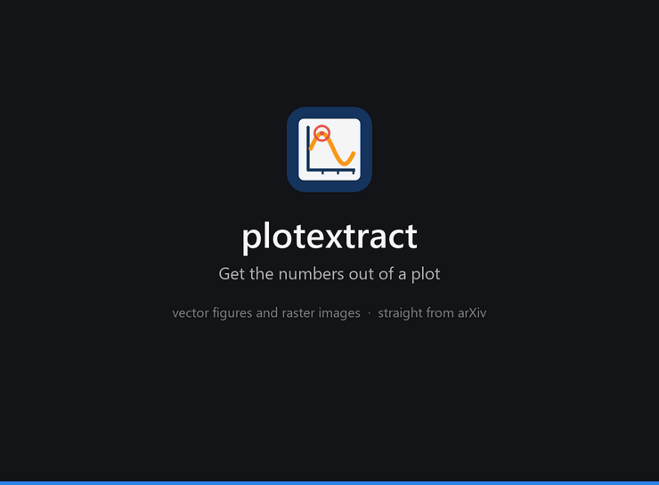
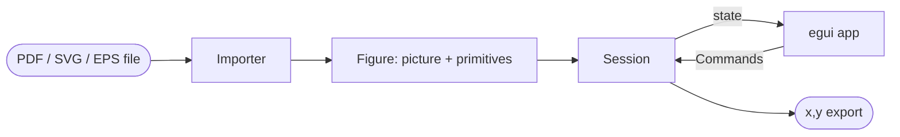
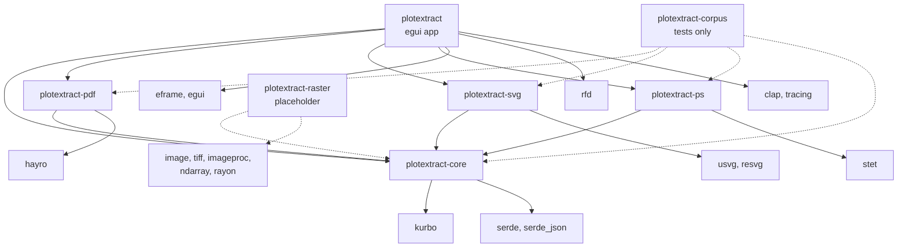

# plotextract

Get the numbers out of a plot. Open a figure that was drawn as vectors (PDF, SVG, EPS or PostScript), tell the app what
two ticks on each axis are worth, click the curves you want, and export their points as `x,y` in the plot's own units.



plotextract does not trace pixels. It reads the paths the figure was drawn with, so every point it exports is a vertex
of the original curve, converted through your calibration. On the matplotlib and Mathematica figures in the test suite
the recovered series are within 0.1% of the plot's extent (matplotlib's are exact to the printed precision).

## What it does

1. **Open** a file: File > Open, drag it onto the window, or `plotextract plot.pdf`.
2. **Calibrate.** Ctrl+click the end point of a tick mark (the pointer snaps to path vertices), right-click and record it
   as *x min*, *x max*, *y min* or *y max*, then type the value that tick stands for (`0.001` and `1e-3` both work). Two ticks per axis; tick *x log* or
   *y log* for logarithmic axes.
3. **Select.** Ctrl+click a curve to select it; Ctrl+Shift+click adds or removes it in the active **series**. A series can
   be any number of curves: one stroke, a dashed line drawn as many pieces, a set of markers.
4. **Export.** *Export CSV* or *Copy numbers* write the active series as `x,y` rows, optionally sorted by x.

| Tool | |
|---|---|
| Hand (default) | drag pans, the wheel zooms about the cursor, Ctrl+0 fits the page |
| Select (hold Ctrl; Cmd on macOS) | the pointer snaps to the nearest vertex, a click selects the curve and the point |
| Right click | records the selected point as a calibration tick |

The side panel has a card for each step: *Calibration* (the four ticks, their positions and values, log axes, a
**Record** button for Ctrl+R; a green dot beside its title and green outlines on an axis's value boxes show that the
axis is calibrated, and hovering the dot says what is missing), *Series*, *Curves* and *Selection*. The Curves table lists every path by **ID** and
**Type** (stroke or fill) with its point count; clicking a row selects the curve, and a curve picked on the canvas scrolls
into view there. Curves can be hidden individually, and strokes, fills and the page picture toggled as layers.

Ctrl+Z and Ctrl+Shift+Z undo and redo. Ctrl+S saves the calibration, series and hidden curves as a project file; File >
Open project reloads it with its figure. Help > About (F1) shows the version, author and licence. Zooming stays sharp:
once the view has been still for a moment, the visible part of the page is re-rendered at screen resolution on a worker
thread.

| Format | Notes |
|---|---|
| PDF | page 1; clipping paths are ignored on purpose, so ticks and lines a PDF clips away can still be picked |
| SVG | units are CSS pixels |
| EPS, PostScript | the EPS bounding box, or the first page; units are points |
| PNG, JPEG, TIFF, ... | not yet: the `plotextract-raster` crate is a placeholder |

Text, images and gradients are drawn but not pickable. Calibration assumes upright axes (no rotated or skewed scans yet).

## Build

You need a stable Rust toolchain, 1.95 or newer (edition 2024), and the platform's usual C toolchain. Nothing else is
needed to compile.

| Platform | Build | At run time |
|---|---|---|
| Windows | MSVC build tools. With the Windows SDK's resource compiler the exe gets its icon; without it the build warns and goes on | a GPU driver (DX12 or Vulkan) |
| Linux | `gcc`/`cc` | X11 or Wayland and a Vulkan or GL driver, loaded dynamically; `xdg-desktop-portal` for the file dialogs |
| macOS | Xcode command line tools | |

```
cargo run --release -p plotextract -- plot.pdf     # run it
cargo test --workspace                             # tests
cargo fmt --all --check
cargo clippy --workspace --all-targets -- -D warnings
```

**Release packages.** `scripts/dist.ps1` (Windows) and `scripts/dist.sh` (Linux, macOS) build the release app for the
platform they run on and write `dist/<platform>/` plus an archive, by default in a `dist` folder next to the repository.
macOS also gets an unsigned `plotextract.app`. `.github/workflows/release.yml` runs both scripts on GitHub's runners and
attaches the archives to a release when a `v*` tag is pushed. Build Linux packages on an old distribution (the workflow
uses Ubuntu 22.04): a binary needs at least the glibc it was built with.

**Build output.** `cargo` writes to `target/`, which git ignores. To keep it out of the working folder, create a local
`.cargo/config.toml` (also ignored):

```toml
[build]
target-dir = "../build"
```

**Test data.** The accuracy tests in `crates/corpus` use real matplotlib and Mathematica figures, each as PDF, SVG and
EPS, with the data that drew them. Those files and their generator scripts are not in this repository. The tests look
for them in a `testdata/` folder next to the repository, or in the folder named by `PLOTEXTRACT_TESTDATA`; without them
those tests print `skipped` and pass.

## How it is built

Importers turn a file into a `Figure`: a page picture plus every stroked and filled path as a candidate **primitive**, in
one coordinate space (origin top left, y down). A `Session` holds everything the user does with a figure (calibration,
series, selection, hidden curves) and changes only through `Command`s, with undo. The egui app is a thin shell that turns
input into commands, so the whole workflow is tested without a window.



### Crates

Solid arrows are dependencies of the shipped code, dashed ones are test-only or not yet used.



| Crate | Role |
|---|---|
| `plotextract-core` | `Figure`, `Primitive`, calibration (linear and log), `Series`, the snap index, `Session` and its `Command`s, project files, CSV formatting, and the path flattening every importer shares. No UI or file-format dependency |
| `plotextract-pdf` | PDF importer: paths through hayro's interpreter, the page picture and sharp region renders through hayro's renderer |
| `plotextract-svg` | SVG importer: paths from usvg's resolved tree, pictures from resvg |
| `plotextract-ps` | PostScript and EPS importer: paths from stet's display list, pictures from stet's renderer |
| `plotextract-raster` | placeholder for raster images; declares the planned image-processing dependencies |
| `plotextract` | the egui application: canvas, side panel, About window, theme, background detail rendering |
| `plotextract-corpus` | tests on real plots (not shipped) |

### External dependencies

| Crate | Used for |
|---|---|
| [hayro](https://github.com/LaurenzV/hayro) | reading and rendering PDF |
| [stet](https://crates.io/crates/stet) | interpreting PostScript and EPS |
| [usvg](https://github.com/linebender/resvg), resvg | parsing and drawing SVG |
| [kurbo](https://crates.io/crates/kurbo) | 2D paths and transforms |
| [eframe / egui](https://github.com/emilk/egui) | window, widgets and drawing |
| rfd | native file dialogs |
| serde, serde_json | project files and test data |
| clap, tracing | command line and logging |
| image, tiff, imageproc, ndarray, rayon | planned raster analysis (declared by `plotextract-raster`, unused so far) |

All are permissively licensed (mostly MIT and/or Apache-2.0).

## Repository layout

```
crates/
  core/            model, calibration, session, snap index, export
  pdf/ svg/ ps/    one importer per format
  raster/          placeholder
  app/             the application (icon assets in app/assets)
  corpus/          accuracy tests on real plots
docs/              the demo GIF
scripts/           dist.ps1, dist.sh and the text shipped with the packages
.github/           CI and release workflows
```

## Licence

Copyright (c) 2026 Rajat Mandal. Licensed under either of [Apache-2.0](LICENSE-APACHE) or [MIT](LICENSE-MIT), at your
option.

The dependencies are under their own licences, all permissive: mostly MIT and/or Apache-2.0, tiny-skia BSD-3-Clause, and
the fonts bundled with egui OFL-1.1 and the Ubuntu Font Licence. None is GPL-only or AGPL.
