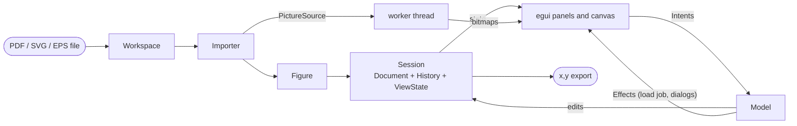
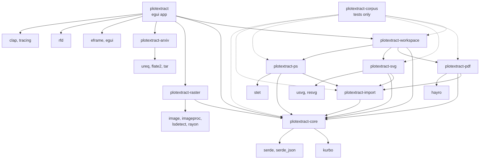

# Architecture

plotextract is a Rust workspace of small crates. The rule that shapes it: a layer knows the layer below, never the one
above, and nothing below the shell knows about a window. Where the structure is going next, and in what order, is in
[plan.md](plan.md).

```
shell        plotextract            egui panels, canvas, dialogs, threads; the Model that decides what happens
service      plotextract-workspace  format registry; open, projects, export, thumbnails
             plotextract-arxiv      an arXiv paper's figures: download, unpack, order (knows no format)
importers    plotextract-pdf / -svg / -ps  (+ plotextract-import: what they share)
domain       plotextract-core       figure, calibration, session, snap index, ports
```

## Domain (`plotextract-core`)

- **`Figure`**: one page of a file. Width and height in the file's own `Unit` (points for PDF and PostScript, CSS pixels
  for SVG), origin top left, y down; its `Primitive`s; which `page` it is of how many (`page_count`); and `truncated`
  when the importer stopped at its limits.
- **`Primitive`**: one stroked or filled path as vertices plus the places where it breaks into pieces. Strokes come
  first, each kind numbered from 0. Importers apply the same flattening rules (PyMuPDF compatible: a rectangle `re` and a
  quad differ in corner order), so the numbers are reproducible.
- **`Session`**: works on a figure. It composes three things that change for different reasons:
  - `Document`: calibration, series, active series, hidden curves. Everything saved in a project and everything undo
    covers. Changed only by an `Edit`; hidden curves are a set, so a snapshot stays small for a figure of a million
    curves.
  - `History<Document>`: snapshots, 200 deep.
  - `ViewState`: layers and the selection. Not saved, not undone.
  and a `SnapIndex`: vertices sorted by x and a bounding box per primitive, both in single precision (about 12 bytes per
  vertex) and used only to choose what to look at; distances come from the real coordinates.
- **Ports**: `Importer` (`sniff`, `extensions`, `import`, `picture`) and `PictureSource` (`render(region, scale)`).
  `OpenOptions` carries the page and password; `ImportError` says `PasswordRequired`, `WrongPassword`, `NoSuchPage` or a
  message. No wording for a user lives here.

## The tracing wizard (raster images)

An image has no paths, so it is traced in steps that work on **masks** (`plotextract_raster::Mask`): for every pixel of the crop,
how much of it belongs to something, 0 to 255. The image itself is read only to make the first masks. The wizard keeps them
by name (`MaskId`): **Crop**, **Exclude**, one mask per ink colour found, the four ticks and the series. Each step makes
its masks from the masks before it, found by their tags: the colour step makes the ink masks (`ColourMap::mask_of`), the
plot area step cuts the ticks out of the colours tagged axes, and the curves step makes the series of the pieces of the
colours tagged curve. Only one mask is
drawn by hand: the exclude mask, with the Exclude tool (a brush, a rectangle or a polygon; Alt erases). Only drawing it is
undone (`History<Vec<MaskOp>>`, Ctrl+Z on step 1 only, so an undo on a later step cannot quietly change what the colours
were found in). Everything else is a choice made again, and any mask is deleted from its row (`WizardIntent::Delete`:
the crop is taken away, the exclude mask emptied, a colour ignored, a tick's line taken away). The pointer has two tools on
step 1, `Tool::Crop` and `Tool::Exclude`; with none chosen it moves the image, and on the later steps lights what it is on.

The wizard has two panels (the module `wizard_panel`). The left one lists `Wizard::visible_masks()`: the masks that exist,
so it grows as the steps are taken (the crop once there is one, the exclude mask once something is excluded, every colour
that is something (a colour that is none of curve, fill, axes or grid is ignored), every tick that has a line, every shape
type, every series that has pieces), in a section for each step that makes masks (Plot, Colours, Ticks, Shapes, Series),
each with a count and an eye for all of its masks; the current step's section is open and the others folded, until one is
opened or folded by hand. The right one is the current step, with a file for each (`step_prepare` has the two tools;
`step_colours` the list of colours; `step_plot_area` the search and the ticks; `step_shapes` the pieces and their shape
types; `step_curves` the series, the editing of their points and the export) and its way on. A row the pointer is on, in
either panel, is outlined on the image.

What the image shows besides the image is decided in one place, `wizard_canvas::scene` (`wizard_canvas/scene.rs`), from the wizard as it is: a mask
is drawn when its eye is open, on its own step and the steps after it (it is what they build on), never on a step before it
(it would be out of date there, or not yet made); what a step chooses from (the lines found, the pieces) is drawn on that
step only, and the points of the series on the curves step, the selected series' full size and the others small and faint.
The painting reads the `Scene` and keeps the pictures it makes until what they show changes.

What a colour is, is a set of `Role`s (`colours.rs`): curve, fill, axes, grid, as many as apply. One ink is often two
things at once (black axes and a black curve); the colour step cannot tell them apart, so it says both, and the later
steps separate them by shape: the line search takes what is tagged axes, the curve step what is tagged curve. A colour
with no role is ignored and has no mask.

Besides its pixels, every mask is described by a `MaskMeta` (`plotextract_raster::meta`): an ID that stays the same while
the mask does, a set of `Tag`s for what it is, and `Properties`, a dictionary of `Value`s for the rest. The wizard makes
them from its state (`Wizard::meta`), so they cannot fall out of step with it, and the steps find their masks by tags
(`Wizard::find_masks(&[Tag::Colour, Tag::Axes])` is the axes colour; the ticks are tagged `Tick` and `XMin` and so on, with
their position and plot value as properties). The masks panel shows each mask's ID, tags and properties when its row is
opened; the wording of tags and values is in `text.rs`.

The third step (**Plot area**) cuts the four tick masks out of the axes mask. `plotextract_raster::lines` looks for
horizontal and vertical lines in a `Mask` with an `Algorithm` the user chooses (the Hough transform from `imageproc`, or the
line segment detector `lsdetect`), after taking out the blocks wider than a line (a morphological opening). What the packages
return is cleaned up: edges of one stroke and neighbouring buckets are merged, and each line's position across it is
recomputed as the coverage-weighted centre in the mask. The wizard keeps the line chosen for each of the four ticks; a
click on a line gives it to the selected tick, a right click opens a menu on it. The four ticks are `plotextract_core::Slot`s,
the same as the vector figures' calibration rows, and the values typed for them and the log axes are kept beside the lines:
`Wizard::calibration()` makes the `Calibration` (positions in image pixels, y down) that the later steps will read. The search
has settings (`lines::Params`: the shortest and widest line and, for the line segment detector, how many times the mask is
enlarged first, since it accepts a segment only if it has more aligned pixels than chance explains); the wizard holds them
and looks again whenever they change. The search runs on a thread like the colour analysis (`Job::Lines`),
but only one at a time: a change made while one runs is remembered, and the answer of the running one starts the next. The
lines found before stay on the image until the new ones arrive.

The fourth step (**Shapes**) finds what the curve colours are drawn with. `plotextract_raster::curves::find` breaks the mask
of each colour tagged curve into pieces, its connected components (`imageproc::region_labelling`), after cutting out of a
colour that is the axes too the sides of the frame: the long lines of step 3 that meet another at a corner
(`PlotArea::frame_lines`; a curve can be as long and straight as an axis, but does not end where a side does). `Pieces` keeps,
for every pixel of the crop, the piece it is in and the coverage, so a piece is found under the pointer at once and traced
without the masks. Then `plotextract_raster::shapes::classify`, with nothing learned beforehand, works out what the pieces
are from the model of what a curve mask holds: curves drawn with a dash pattern (many copies of one or two shapes, a stroke
wide, turned with the path, a few strokes apart), marker series (copies of one upright shape, as far apart as the data),
solid lines, and what is not data (letters, which differ from their neighbours and sit close together; odd pieces).

- Markers glued onto the line through them are taken off it first: in a piece much thicker in places than its line,
  what a disc a little wider than the line fits in becomes pieces of its own (a morphological opening, from a chamfer
  distance transform).
- Each piece is described in terms that do not change when it is turned (`Look`): area, the sides of the rectangle with
  its second moments, how much of that rectangle it fills, holes, stroke thickness; and one that does, how much of its
  upright bounds it fills, which tells a diamond from a square (markers stand upright, the dots of a line do not).
- Pieces that look alike, of one colour, are grouped; a group that recurs (four or more) is a constituent shape.
- Recurring solid pieces whose gap (estimated from the looks along the line between them) is at most a few strokes are
  linked; where a piece has more than two links the pair that runs on straightest is kept, so a dot beside the path (the
  dot of an *i*) is not taken in. Runs of six or more are paths; each is lengthened at its ends by pieces just ahead that
  are no more than a few dots (dots run together where a path folds), and paths whose ends nearly meet and that are made
  of the same shapes are joined.
- A recurring group mostly on paths is dots or dashes (by its roundness), and its copies on no path are strays; one
  that recurs off paths is markers; long pieces of one width are lines; groups of three or more different shapes close
  together are text; the rest is other.

`Shapes` keeps each piece's look and type, the types (`ShapeType`: colour, kind, pieces, its typical piece and its pieces
from the oddest, spacing) and the paths; `Shapes::curves` groups the paths of one curve (the shape one is mostly made of is
in the other too) and `Shapes::order` puts pieces in order along their paths. How alike two pieces are is one number,
`shapes::unlike` (the largest of their differences, each over what copies may differ by), so the strictness of the grouping
is one setting (`shapes::Params::tolerance`), the typical piece is the one nearest the average, and the odd ones are those
most unlike it. Each type is a mask (`MaskId::Shape`, tagged `Shape`, its kind, and `ByHand` once changed).

What is changed by hand is a list of `shapes::Edit`s (say a kind, move a piece, merge two types, make an empty type, cut or
join a path), each naming its pieces by a pixel of theirs and its types by a pixel of a piece in them, or by number for a
type made by hand. `Shapes::apply` makes one; `ShapeStep` keeps the list and makes it again, in order, on the shapes of every
new search, so an edit means the same thing as long as its pieces are found. Types keep their places in the list while
edited (an emptied one is simply not listed), so a selection and the hidden ones stay valid. Moving one piece offers the
pieces of the type it left that look more like it than like the type's typical piece (`Shapes::alike_in`). The panel
lists the types in the order of `Wizard::shape_order` (by kind, the most pieces first), with pictures of their pieces
(`wizard_panel/thumbs.rs`, kept until the shapes change); the canvas's shapes tool selects, moves pieces (a click, or a
drag around them, which then does not pan) or cuts and joins paths, as `ShapeClick` says, and draws the links. A part of
the image is brought into view with `Intent::ShowArea`, which the shell gives to `View::show`. The pieces and their shapes
are one thread job (`Job::Pieces`), which waits for a running line search, since it cuts out the lines it finds.

The fifth step (**Curves**) makes the series. A series (`CurveSeries`) is a list of seed pixels, one per piece, so it keeps
its pieces however often they are found again, with the points put in and taken out by hand. For each curve colour the
series are proposed from its shapes (`CurveStep::propose`): one per curve of dots and dashes (traced as `Pattern`), one
for its lines, one per type of marker, of the pieces inside the frame (`PlotArea::frame`; with one side of a direction found,
the plot is on the side of it toward the middle of the crop) and not on the ticks of the frame (`Wizard::tick_bands`: the
short lines that stand across a side and end on it). They are proposed afresh whenever the shapes change, until a series
of the colour is changed by hand. Whenever the pieces or a series change, every series is traced again (`CurveStep::retrace`; a change to one series traces only it):
`Pieces::trace` gives a point for every column of each piece at the centre of its coverage (the faint pixels at the
stroke's edges included) for a line, the centre of each piece for markers, and for a pattern the centre of each dot and a
point every stroke width along each dash (dots run together give their centres), in order along the path. Points taken out
by hand are left out (within 1.5 pixels), points put in are added (into a pattern where they lengthen its path least); a
point put in by a click goes to the centre of the ink near it (`Pieces::centre_near`). A series is written as a vector
figure's series of one curve (`Series::to_csv`), with the calibration of step 3, so the CSV, the copy and their errors are
the same as for vector figures; a pattern is written in the order of its path rather than sorted by x, since a curve that
doubles back is not one value of x. The model sends Copy and Save CSV to the wizard's selected series while an image is
traced.

## Importers

Each walks its format's drawing model and feeds every painted path to `plotextract_import::PrimitiveBuilder`:

- `flatten_path` turns a path into vertices with the shared Bezier sampling and break handling.
- `PrimitiveBuilder` numbers the paths and **enforces the limits**: 1,000,000 paths, 16,000,000 vertices. Past them it
  drops the rest, remembers it (`truncated`), and `has_room()` lets importers skip flattening paths that would be
  dropped.

Format specifics:

| | |
|---|---|
| PDF (hayro) | implements `hayro_interpret::Device`; clipping is ignored on purpose; `Pdf::new_with_password`; a wrong or missing password is reported as such; the file's bytes are shared (`Arc`), not copied |
| SVG (usvg, resvg) | the resolved tree's paths; a document with several pages is not a thing, so page 0 only |
| PostScript (stet) | the display list of the page; the interpreter runs under a 20 second limit enforced by setting stet's interrupt flag from a watchdog thread |

A `PictureSource` is created on the thread that uses it (hayro's and stet's renderers are not `Send`) by
`Importer::picture`, from the same bytes and options as the figure.

## Application service (`plotextract-workspace`)

- `Registry`: finds the importer by content (the first kilobyte), then by extension.
- `Source`: the bytes, the importer and the `OpenOptions` of a file. Cheap to clone, `Send`; `with_page` and
  `with_password` give variants; `picture()` makes a `PictureSource`.
- `Workspace`: `read` (file to `Source`), `load` (interpret a `Source` into an `Opened`: a `Session` plus its `Source`),
  `open` (both), projects (`save_project`, `read_project`) and CSV export. It refuses a page without a finite positive
  size.
- `Opened::picture_source()` is `None` for a truncated figure: a file that heavy is not drawn.
- `Workspace::thumbnail` opens a file and draws its first page small; `Registry::opens_name` says whether a file name has
  an extension that opens.

## arXiv (`plotextract-arxiv`)

`ArxivId::parse` reads a paper's number however it is written (with or without `arXiv:` or a version, old style, or a
link to any page of it) and accepts only the two forms arXiv uses, so it is safe in a URL. `fetch` asks a `Downloader`
for the source (`Arxiv` gets `https://arxiv.org/src/<id>` with ureq over rustls; the tests give a fake) and the version
from the `Content-Disposition` file name, then `unpack`s it into `<cache>/<id with version>`: a gzipped tar (most
papers), a gzipped single TeX file (no figures), or the PDF alone (offered whole). The source is someone else's file, so
only the files the caller calls figures are written; a name with `..`, a root, a drive, a colon, a Windows device name
or a control character is skipped, and links and folders are not made. Gzip output is cut off at 4 GB and the download
at 1 GB. The TeX files are read for `\includegraphics` (`\includesvg`, `\epsfig`, `\psfig`), resolved with
`\graphicspath` from the top folder and the TeX file's own, main files first; the figures they draw come first, in that
order.

In the shell, `Intent::FetchArxiv` makes a `Job::Arxiv`; `Model::finish_arxiv` keeps the `Paper` and asks for an
`Effect::RunBatch` of a `Job::Thumbnail` per figure, which four threads take in turn (through
`Workspace::thumbnail`), so the first pictures show while the rest are drawn. The window's state (`ArxivImport`) stays
in the model after it is closed, so a second figure of the paper is a click away; `Intent::ImportFigure` opens the
unpacked file like any other, so a project made from it finds it again in the cache.

## Shell (`plotextract`)

```
 input ──► Intent ──► Model::dispatch ──► Effect ──► shell performs it
                          │                              │
                          ▼                              ▼
                       Session                dialogs, clipboard, title,
                                              background threads
```

- `Model` owns the `Session` (and the `Source`, the sessions of other pages that have work on them, the status message,
  the password prompt). It has no egui in it, so the tests drive it with intents. `text.rs` is the one place that turns
  facts (errors, units, calibration status) into sentences.
- **Slow work is a job.** `Intent::Open` makes a `Job::Load`; `dispatch` returns it as `Effect::Run`. The kinds of job
  are one enum (`jobs.rs`: open a file, look at the colours, search for lines, for pieces and shapes, download a paper,
  draw a figure small); the shell runs every one the same way, with one `Runner`: a thread per job (a few workers for a
  batch) and one channel for the answers, which go to `Model::finish` (a figure's picture to the arXiv window). Jobs are
  numbered; the answer to any job but the newest is dropped, so quickly opening two files shows the second. A password error does not fail: it
  becomes a `PasswordPrompt` the shell shows as a window, and the typed password starts a new job. Project loading reads
  the (small) project file at once and starts a job only if its figure is not the open one.
- **Pages.** `Intent::GoToPage` reopens the same `Source` at another page without touching the file. A page the user
  worked on (`Session::has_work`) is parked and comes back instantly; opening a different file forgets the parked pages.
- **`CanvasState`** (view, hover, pictures, worker) and **`PanelState`** (value cells, table scroll) are the widgets'
  own memory. `canvas::show` and `panel::show` read the model and return `Vec<Intent>`.
- **The modules** follow the steps. `model/` is the model (`mod.rs`: intents, effects, dispatch) with `opening.rs` (load
  jobs, pages, passwords, projects), `tracing.rs` (the wizard's jobs) and `arxiv_import.rs`. `wizard/` is the wizard's
  state, a module per step (`prepare`, `colour_step`, `plot_area`, `shape_step`, `curve_step`), each owning its fields,
  its changes and its masks' metadata; `mod.rs` holds the step and the selection and routes each `WizardIntent` to its
  step, and what a step reads from the steps before it is passed to it. `wizard/masks.rs` is the one place that goes
  through every kind of mask for the UI (`Wizard::view`: section, picture, info, delete tip). `wizard_canvas/` is the
  image while tracing: `scene.rs` (what is drawn when), `pictures.rs` (the overlays and their caches) and `tools/`, the
  pointer, menu and drawing of each step. The steps and the kinds of mask are closed sets, so they are enums matched in
  one place each; traits are kept for the seams that have more than one implementation (importers, the downloader).
- **Pictures** are drawn by one worker thread per open figure (`detail.rs`). Requests are `Base` (the whole page at up to
  6 pixels per unit and 4096 pixels) or `Detail` (the visible part at screen resolution, only when the view has been still
  for 250 ms and shows more than 1.15 times the base resolution). The worker keeps the newest request of each kind and
  skips what is stale. Bitmaps are cut into GPU-sized tiles.

## Resource limits

| Limit | Value | Where |
|---|---|---|
| Paths kept from a file | 1,000,000 | `plotextract_import::MAX_PRIMITIVES` |
| Vertices kept from a file | 16,000,000 | `MAX_POINTS` |
| Longest side of a picture | 16,384 px | `MAX_PICTURE_PIXELS` |
| Base picture | 4,096 px, 6 px per unit | `detail.rs` |
| Detail render | 12 million pixels | `detail.rs` |
| PostScript run time | 20 s | `plotextract-ps` |
| arXiv source downloaded | 1 GB | `plotextract_arxiv::MAX_DOWNLOAD` |
| arXiv source unpacked | 4 GB, 100,000 files | `MAX_UNPACKED`, `unpack.rs` |
| Undo depth | 200 | `session.rs` |
| Curves outlined at once | 10,000 | `canvas.rs` |

## Frame cost

The canvas does not draw what cannot be seen. A curve's screen points are produced by `screen_runs`: the stretches
outside the view are dropped and points within a pixel of the last one are skipped, so a two-million-vertex curve is a few
thousand points at any zoom. Curves smaller than a pixel are not outlined, and neither is anything when more than 10,000
are in view. Visibility uses the index's bounding boxes, not a pass over every vertex. `docs/testing.md` shows how to
measure it.

While an image is traced, the work done on the window's thread in answer to a click is small and local: a change to a
series traces that series again, not all of them; the picture of the pieces is made again only when which pieces are in
which series, or shown, changes (a point put in or taken out is drawn on its own); a search for pieces asked for with the
same colours, frame and settings as the last is not run. `cargo test --release -p plotextract how_responsive -- --ignored
--nocapture` measures it (see `docs/testing.md`).

## The flow of a vector figure



## Crates

Solid arrows are dependencies of the shipped code, dashed ones are test-only.



| Crate | Role |
|---|---|
| `plotextract-core` | `Figure`, `Primitive`, calibration (linear and log), `Series`, the snap index, and `Session` with its `Document`, `History` and `ViewState`; project files and CSV formatting; the `Importer` and `PictureSource` ports. No UI or file-format dependency |
| `plotextract-import` | what the importers share: path flattening with the PyMuPDF-compatible rules, the primitive builder with its limits, and the picture size limits |
| `plotextract-pdf` | PDF importer: paths through hayro's interpreter, pictures through hayro's renderer; pages and passwords |
| `plotextract-svg` | SVG importer: paths from usvg's resolved tree, pictures from resvg |
| `plotextract-ps` | PostScript and EPS importer: paths from stet's display list, pictures from stet's renderer; runs the program under a time limit |
| `plotextract-workspace` | the registry of formats (by content, then extension) and the operations on a document: open, projects, export |
| `plotextract-raster` | raster images, with no UI: decoding, drawing at any scale, the crop and exclude masks, the ink colours, masks, the straight lines of a mask, the pieces of the curves and the shapes they are (what the tracing wizard is built from) |
| `plotextract-arxiv` | the figures of an arXiv paper, with no UI: the number read however it is written, the source downloaded and unpacked safely, its figure files put in the order the TeX files draw them |
| `plotextract` | the egui application: `Model` (intents, effects, jobs run on threads), canvas, side panels, the tracing wizard (a module per step, its canvas a tool per step), the Import from arXiv window, About window, theme, worker-thread rendering |
| `plotextract-corpus` | tests on real plots and awkward files, and the `probe` tool (not shipped) |

## External dependencies

| Crate | Used for |
|---|---|
| [hayro](https://github.com/LaurenzV/hayro) | reading and rendering PDF |
| [stet](https://crates.io/crates/stet) | interpreting PostScript and EPS |
| [usvg](https://github.com/linebender/resvg), resvg | parsing and drawing SVG |
| [kurbo](https://crates.io/crates/kurbo) | 2D paths and transforms |
| [eframe / egui](https://github.com/emilk/egui) | window, widgets and drawing |
| rfd | native file dialogs |
| serde, serde_json | project files and test data |
| clap, tracing | command line and logging |
| image, imageproc, lsdetect, rayon | raster images: decoding, morphology and the Hough transform, line segment detection, parallel loops |
| [ureq](https://github.com/algesten/ureq) (with rustls), flate2, tar | downloading an arXiv paper's source over HTTPS and unpacking it |

All are permissively licensed (mostly MIT and/or Apache-2.0).

## Repository layout

```
crates/
  core/            figure, calibration, session (document, history, view), snap index, export
  import/          flattening, primitive builder and limits shared by the importers
  pdf/ svg/ ps/    one importer per format
  workspace/       format registry; open, project and export operations
  raster/          raster images: decoding, masks, colours, straight lines, pieces and shapes (the tracing wizard's engine)
  arxiv/           an arXiv paper's figures: download, unpack, order
  app/             the application (icon assets in app/assets)
  corpus/          accuracy and stress tests on real plots, and the probe tool
docs/              architecture, testing, the demo GIF
scripts/           dist.ps1, dist.sh and the text shipped with the packages
.github/           CI and release workflows
CHANGELOG.md
```

The dependencies are under their own licences, all permissive: mostly MIT and/or Apache-2.0, tiny-skia and subtle
BSD-3-Clause, ring, untrusted and rustls-webpki ISC (ring also Apache-2.0), the root certificates of webpki-roots
CDLA-Permissive-2.0, and the fonts bundled with egui OFL-1.1 and the Ubuntu Font Licence. None is GPL-only or AGPL.
