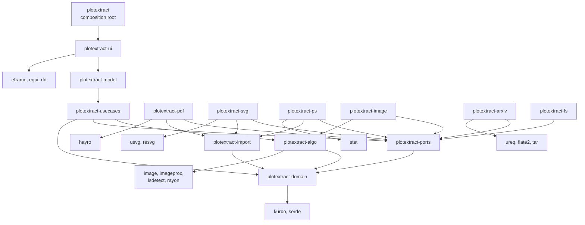

# Architecture

plotextract is a Rust workspace of small crates in layers, ports and adapters style. One rule shapes it: **every
dependency points inward**. The domain depends on nothing of ours; the algorithms and the ports on the domain; the use
cases on those three; the model on the use cases; the window on the model. The adapters (file formats, arXiv, the disk)
implement the ports, and only the composition root knows them all. `crates/corpus/tests/layers.rs` checks the rule on
every crate's manifest, and that nothing inside the model knows a window, the network, a file format or the disk.

```
composition root  plotextract (crates/app)   builds the adapters, hands them to the model through the ports, runs the window
ui                plotextract-ui             egui: the shell, panels, canvas, a tool for each step of the wizard
model             plotextract-model          intents in, effects out, jobs handed to the shell; the wording of messages
use cases         plotextract-usecases       the vector session, the library of files, the tracing wizard
ports             plotextract-ports          Importer, PictureSource, PaperSource, Files
algorithms        plotextract-algo           decoding, ink colours, straight lines, pieces and their groups; pure
domain            plotextract-domain         figure, primitives, calibration, series, history, snap index, masks
adapters          plotextract-pdf, -svg, -ps (+ -import), -image, -arxiv, -fs: the ports implemented
```

Inside, the patterns are few and named:

- **Ports and adapters.** A format is an `Importer` (with its `PictureSource`); arXiv is a `PaperSource`; the disk is
  `Files`. The use cases see only the traits, so the tests swap in fakes (an arXiv that serves one tar from memory) and
  the composition root chooses the real ones.
- **Model, view, update.** The window turns input into `Intent`s; `Model::dispatch` changes the state and returns
  `Effect`s that only the shell can perform (a dialog, the clipboard, a thread).
- **Command and memento.** Every change that can be undone is a value (an exclude shape, an edit of the groups, a link)
  applied to state whose earlier versions a `History` keeps; one `History` type serves the vector session, the exclude
  mask, the groups and the links.
- **State.** The wizard's steps are modules that own their state; the `WizardStep` trait is what each is to the wizard
  (its undo), so Ctrl+Z reaches the step on screen with no arm per step.
- **Strategy.** The straight lines are found by an `Algorithm` the user picks (the Hough transform or the line segment
  detector); the grouping by a tolerance.
- **Blackboard.** The steps talk through masks found by tag (`Wizard::find_masks(&[Tag::Colour, Tag::Curve])`), so a
  step reads what the steps before it made without reaching into them.

## Domain (`plotextract-domain`)

- **`Figure`**: one page of a file. Width and height in the file's own `Unit` (points for PDF and PostScript, CSS pixels
  for SVG), origin top left, y down; its `Primitive`s; which `page` of the file it is; and `truncated` when the importer
  stopped at its limits.
- **`Primitive`**: one stroked or filled path as vertices plus the places where it breaks into pieces. Strokes come
  first, each kind numbered from 0. Importers apply the same flattening rules (PyMuPDF compatible: a rectangle `re` and a
  quad differ in corner order), so the numbers are reproducible.
- **`Document`**: calibration, series, active series, hidden curves. Everything saved in a project and everything undo
  covers. Changed only by an `Edit`; hidden curves are a set, so a snapshot stays small for a figure of a million curves.
- **`History<S>`**: snapshots of any state, 200 deep.
- **`SnapIndex`**: vertices sorted by x and a bounding box per primitive, both in single precision (about 12 bytes per
  vertex) and used only to choose what to look at; distances come from the real coordinates.
- **`raster`**: `Mask` (how much of each pixel of the crop belongs to something), `MaskMeta` (ID, `Tag`s and properties)
  and `Prepare` (the crop and the exclude shapes, rasterized onto any grid).
- **`ArxivId`**: a paper's number, read however it is written, safe in a URL.
- `OpenOptions` carries the page and password; `ImportError` says `PasswordRequired`, `WrongPassword`, `NoSuchPage` or a
  message. No wording for a user lives here.

## Use cases (`plotextract-usecases`)

- **`Session`** works on a vector figure: its `Document`, a `History<Document>` and a `ViewState` (layers and the
  selection: not saved, not undone), and the `SnapIndex`.
- **The library** (`Workspace`, through `Files` and a `Registry` of importers): `read` (file to `Source`), `load`
  (interpret a `Source` into an `Opened`: a `Session` plus its `Source`), `open` (both), projects and CSV export, and
  `thumbnail`. It refuses a page without a finite positive size; `Opened::picture_source()` is `None` for a truncated
  figure. `Registry` finds the importer by content (the first kilobyte), then by extension.
- **The wizard**, below.

## The tracing wizard (raster images)

An image has no paths, so it is traced in steps that work on **masks** (`plotextract_domain::Mask`): for every pixel of the crop,
how much of it belongs to something, 0 to 255. The image itself is read only to make the first masks. The wizard keeps them
by name (`MaskId`): **Crop**, **Exclude**, one mask per ink colour found, the four ticks and the groups of pieces. Each step makes
its masks from the masks before it, found by their tags: the colour step makes the ink masks (`ColourMap::mask_of`), the
plot area step cuts the ticks out of the colours tagged axes, and the shapes step groups the pieces of the colours
tagged curve. Only one mask is drawn by hand: the exclude mask, with the Exclude tool (a brush, a rectangle or a polygon;
Alt erases). What a slipping hand does can be undone, on its own step only (so an undo on a later step cannot quietly
change what the colours were found in): drawing the exclude mask on step 1 (`History<Vec<MaskOp>>`), and the changes to
the groups on step 4. Everything else is a choice made again, and any mask is deleted from its row (`WizardIntent::Delete`:
the crop is taken away, the exclude mask emptied, a colour ignored, a tick's line taken away). The pointer has two tools on
step 1, `Tool::Crop` and `Tool::Exclude`; with none chosen it moves the image, and on the later steps lights what it is on.

The wizard has two panels (the module `wizard_panel`). The left one lists `Wizard::visible_masks()`: the masks that exist,
so it grows as the steps are taken (the crop once there is one, the exclude mask once something is excluded, every colour
that is something (a colour that is none of curve, fill, axes or grid is ignored), every tick that has a line), in a
section for each step that makes masks (Plot, Colours, Ticks; the groups of step 4 are masks too, but listed on their step),
each with a count and an eye for all of its masks; the current step's section is open and the others folded, until one is
opened or folded by hand. The right one is the current step, with a file for each (`step_prepare` has the two tools;
`step_colours` the list of colours; `step_plot_area` the search and the ticks; `step_shapes` the selection, the groups and
how the pieces are found; `step_links` the group to link, the links in order, and the copying and saving) and its way on. A row the pointer is on, in
either panel, is outlined on the image.

What the image shows besides the image is decided in one place, `wizard_canvas::scene` (`wizard_canvas/scene.rs`), from the wizard as it is: a mask
is drawn when its eye is open, on its own step and the steps after it (it is what they build on), never on a step before it
(it would be out of date there, or not yet made); what a step chooses from (the lines found, the pieces) is drawn on that
step only.
The painting reads the `Scene` and keeps the pictures it makes until what they show changes.

What a colour is, is a set of `Role`s (`colours.rs`): curve, fill, axes, grid, as many as apply, said by the user;
nothing is guessed from the colour. One ink is often two things at once (black axes and a black curve): the user says
both, and the later steps separate them by shape: the line search takes what is tagged axes, the shapes step what is
tagged curve. A colour with no role is ignored and has no mask. The steps measure and group; what anything is, only the
user says.

Besides its pixels, every mask is described by a `MaskMeta` (`plotextract_domain::raster::meta`): an ID that stays the same while
the mask does, a set of `Tag`s for what it is, and `Properties`, a dictionary of `Value`s for the rest. The wizard makes
them from its state (`Wizard::meta`), so they cannot fall out of step with it, and the steps find their masks by tags
(`Wizard::find_masks(&[Tag::Colour, Tag::Axes])` is the axes colour; the ticks are tagged `Tick` and `XMin` and so on, with
their position and plot value as properties). The masks panel shows each mask's ID, tags and properties when its row is
opened; the wording of tags and values is in `text.rs`.

The third step (**Plot area**) cuts the four tick masks out of the axes mask. `plotextract_algo::lines` looks for
horizontal and vertical lines in a `Mask` with an `Algorithm` the user chooses (the Hough transform from `imageproc`, or the
line segment detector `lsdetect`), after taking out the blocks wider than a line (a morphological opening). What the packages
return is cleaned up: edges of one stroke and neighbouring buckets are merged, and each line's position across it is
recomputed as the coverage-weighted centre in the mask. The wizard keeps the line chosen for each of the four ticks; a
click on a line gives it to the selected tick, a right click opens a menu on it. The four ticks are `plotextract_core::Slot`s,
the same as the vector figures' calibration rows, and the values typed for them and the log axes are kept beside the lines:
`Wizard::calibration()` makes the `Calibration` (positions in image pixels, y down) that the later steps will read. The search
has settings (`lines::Params`: the shortest and widest line and, for the line segment detector, how many times the mask is
enlarged first, since it accepts a segment only if it has more aligned pixels than chance explains); the wizard holds them
and looks again whenever they change. The search runs on a thread like the colour analysis (`Job::Lines`),
but only one at a time: a change made while one runs is remembered, and the answer of the running one starts the next. The
lines found before stay on the image until the new ones arrive.

The fourth step (**Shapes**) groups the pieces of the curve colours, and lets the groups be fixed by hand; nothing else.
`plotextract_algo::curves::find` breaks the mask of each colour tagged curve into pieces, its connected components
(`imageproc::region_labelling`), after cutting out of a colour that is the axes too the sides of the frame: the long lines
of step 3 that meet another at a corner (`PlotArea::frame_lines`; a curve can be as long and straight as an axis, but
does not end where a side does). `Pieces` keeps, for every pixel of the crop, the piece it is in, so a piece is found under
the pointer at once. Then `plotextract_algo::shapes::classify` measures and groups, and says nothing of what a piece is
(a dot of a curve, a marker, a letter): that is the user's to see.

- Markers glued onto the line through them are taken off it first: in a piece much thicker in places than its line,
  what a disc a little wider than the line fits in becomes pieces of its own (a morphological opening, from a chamfer
  distance transform).
- Each piece is described in terms that do not change when it is turned (`Look`): area, the sides of the rectangle with
  its second moments, how much of that rectangle it fills, holes, stroke thickness; and one that does, how much of its
  upright bounds it fills, which tells a diamond from a square.
- A drawing is a solid line or a series of shapes. Each long stroke (`Look::is_line`) is a group of its own; pieces of
  one colour that look alike, four or more, are one group (`ShapeType`), split in two when how upright its pieces stand is
  bimodal. The rest belong to no group: they are left over (`Shapes::leftovers`).

How alike two pieces are is one number, `shapes::unlike` (the largest of their differences, each over what copies may
differ by), so the strictness of the grouping is one setting (`shapes::Params::tolerance`), the typical piece of a group
is the one nearest the average, and its odd ones are those most unlike it. A group is named by how its typical piece
looks (`Look::form`: line, dots, dashes, rings, hollow, open or filled marks), numbered among those that look the same in
the order they were found (`Wizard::group_name`): a name, not a meaning. Each group is a mask (`MaskId::Shape`, tagged
`Shape`, `Line` for a solid line, and `ByHand` once changed).

The user fixes the groups with a selection of pieces (`ShapeStep::selected`) and two edits (`shapes::Edit`): **Join** (the
pieces become one group and nothing else is in it; a group all of whose pieces are among them is the one they become, so a
merge keeps the larger group's number) and **Remove** (the pieces leave their groups). Each names its pieces by a pixel of
each; `ShapeStep` keeps the list and makes it again, in order, on the groups of every new search, so an edit means the same
as long as its pieces are found; undoing makes the list less its last edit again on the groups as found. Groups keep
their numbers while edited (an emptied one is not listed), so the hidden ones stay valid, and the selection follows its
pieces by their pixels across a new search. *Select similar* adds the pieces like one of those selected
(`Shapes::similar`).

The canvas (`wizard_canvas/tools/shapes.rs`) darkens the image and draws every piece in its group's colour, grey for the
leftovers, with a dark rim; zoomed out, a picture pixel shows a piece if any image pixel it stands for is one (made at a
power-of-two scale, so zooming makes it again only now and then), and a piece smaller on screen than 12 pixels (or of a
group whose typical piece is) gets a ring, so a one-pixel piece is seen at any zoom. While some pieces are selected the
others are faint and the selected ringed in white; the group under the pointer has white-edged rings. A click selects a
piece's group (Shift toggles a group, Ctrl one piece), a drag around pieces selects them (Shift adds, Alt takes away), and
on this step the primary button does not pan. The panel lists the groups in the order of `Wizard::shape_order` (repeated
shapes, then lines, the most pieces first) with pictures of their typical pieces (`wizard_panel/thumbs.rs`), then the
leftovers. A part of the image is brought into view with `Intent::ShowArea`, which the shell gives to `View::show`. The
pieces and their groups are one thread job (`Job::Pieces`), which waits for a running line search, since it cuts out the
lines it finds.

The fifth step (**Link**) puts the pieces of a curve in order by hand, as a pen draws a polyline (`wizard/link_step.rs`).
A link is a list of seed pixels, so it keeps its pieces when they are found again; the links are in an order of their own,
and one may be open, being made. A click on a piece adds it to the open link (taking it out of any other) or starts one;
a double-click or Esc ends it; a click on an end of a link reopens it (from its first piece, turned round). The pieces
that can be clicked are those of the group chosen (`Wizard::link_group`, at first the one most of the shapes step's
selection is in). Every change keeps the links before it, to be undone. The canvas (`wizard_canvas/tools/links.rs`)
draws each link as a line through the centres of its pieces with a square on each and its number at its start, a dashed
line from the open link's last piece to the pointer, and a ring around each piece of the group not linked yet; a drag
links the pieces it passes through, looking along the way the pointer came so that none is jumped. The points are the
centres of the pieces, link after link (`Wizard::link_points`), written as a vector figure's series of one curve
(`Series::to_csv`) with the calibration of step 3; the model sends Copy and Save CSV to them while an image is traced.

**Saving the tracing.** A project saved while an image is traced holds the wizard's work (`wizard/work.rs`, `Work`):
the step shown, the crop and the exclude shapes, the tolerance and what each colour was said to be (by its colour), the
ticks with their values, the settings of the searches, the edits of the groups and the links. Nothing found from them is
saved. `Project::tracing` keeps it as JSON, since the domain does not know the wizard. Loading such a project opens the
image afresh (even if it is the one open) and `Wizard::restore` puts the work back with nothing to undo. The colours
are looked at at once (unless the step was the first); when they are found, each takes the roles of the saved colour
nearest it, and then the lines and the pieces are looked for on the step saved, with the edits and the links made again
on them. The model starts the jobs that follow an analysis, which is what carries a restored wizard through. `real_eval`
replays such a project to score what its links export (see `docs/testing.md`).

## Importers

Each walks its format's drawing model and feeds every painted path to `plotextract_import::PrimitiveBuilder`:

- `flatten_path` turns a path into vertices with the shared Bezier sampling and break handling.
- `PrimitiveBuilder` numbers the paths and **enforces the limits**: 1,000,000 paths, 16,000,000 vertices. Past them it
  drops the rest, remembers it (`truncated`), and `has_room()` lets importers skip flattening paths that would be
  dropped.

Format specifics:

| | |
|---|---|
| PDF (hayro) | implements `hayro_interpret::Device`; clipping is ignored on purpose; `Pdf::new_with_password`; a wrong or missing password is reported as such; the file's bytes are shared (`Arc`), not copied |
| SVG (usvg, resvg) | the resolved tree's paths; a document with several pages is not a thing, so page 0 only |
| PostScript (stet) | the display list of the page; the interpreter runs under a 20 second limit enforced by setting stet's interrupt flag from a watchdog thread |

A `PictureSource` is created on the thread that uses it (hayro's and stet's renderers are not `Send`) by
`Importer::picture`, from the same bytes and options as the figure.

**What a document holds.** A format whose files are documents (`Importer::is_document`: PDF) is not opened at once: a
page of it, or an image a page draws, is chosen first. `Importer::contents` lists a file's pages and the raster images
they draw (`Embedded`: the page, its place among that page's images, its size); `Importer::image` gives one of them as
the bytes of a PNG file. The defaults are one page and no images. The PDF importer implements them with a second
`Device` (`ImageFinder`) run over
each page. It counts the distinct raster images a page draws (by hayro's cache key, so one drawn twice counts once,
and those under 16 pixels a side are left out). It decodes the one asked for (`RasterImage::with_rgba`), lays it on
white where it is transparent and writes it as PNG with `image`. An image drawn on several pages is listed once, on
the first. `Source::contents` lists a file read, and `Workspace::image_of` makes a `Source` of one image.
`Workspace::open_image_of` writes that image into the cache folder (`<cache>/pdf/<document>-<hash>-page<p>-image<i>.png`,
the hash of the document's bytes, so two documents of one name do not share it) and opens it, so a project made from it
finds it again. The composition root puts the cache beside the arXiv papers'.

In the shell, the load job of a file opened (`What::File` with `choose`) reads it, and for a document answers with its
contents (`Outcome::Listed`) instead of a figure. A password is asked for first, as for any file. `Model::list_document`
keeps the `Document`, with the `Source` it was read into, and asks for an `Effect::RunBatch` of a `Job::PartPicture`
per page and per image (a page drawn small, or an image taken out and drawn small). `Intent::ImportPart` opens a page
(`What::Page`, the source at that page) or an image (`What::Image`) in another load job, without reading the file again.
A project names its page, so its load does not choose (`choose: false`). The window (`pdf_window.rs`) shows the images,
then the pages (an image is the plot itself, a page the plot with what surrounds it), each in a section that folds
away, on the same cards as the arXiv window (`cards.rs`); every PDF opened goes through it, a figure from
arXiv as well. There is no moving between pages once one is open: another page is chosen by opening the file again.

## arXiv (`plotextract-arxiv`, behind `PaperSource`)

`ArxivId::parse` reads a paper's number however it is written (with or without `arXiv:` or a version, old style, or a
link to any page of it) and accepts only the two forms arXiv uses, so it is safe in a URL. `ArxivPapers` implements
`PaperSource`: it asks a `Downloader`
for the source (`Arxiv` gets `https://arxiv.org/src/<id>` with ureq over rustls; the tests give a fake) and the version
from the `Content-Disposition` file name, then `unpack`s it into `<cache>/<id with version>`: a gzipped tar (most
papers), a gzipped single TeX file (no figures), or the PDF alone (offered whole). The source is someone else's file, so
only the files the caller calls figures are written; a name with `..`, a root, a drive, a colon, a Windows device name
or a control character is skipped, and links and folders are not made. Gzip output is cut off at 4 GB and the download
at 1 GB. The TeX files are read for `\includegraphics` (`\includesvg`, `\epsfig`, `\psfig`), resolved with
`\graphicspath` from the top folder and the TeX file's own, main files first; the figures they draw come first, in that
order.

In the shell, `Intent::FetchArxiv` makes a `Job::Arxiv`; `Model::finish_arxiv` keeps the `Paper` and asks for an
`Effect::RunBatch` of a `Job::Thumbnail` per figure, which four threads take in turn (through
`Workspace::thumbnail`), so the first pictures show while the rest are drawn. The window's state (`ArxivImport`) stays
in the model after it is closed, so a second figure of the paper is a click away; `Intent::ImportFigure` opens the
unpacked file like any other, so a project made from it finds it again in the cache.

## Model and window (`plotextract-model`, `plotextract-ui`)

```
 input ──► Intent ──► Model::dispatch ──► Effect ──► shell performs it
                          │                              │
                          ▼                              ▼
                       Session                dialogs, clipboard, title,
                                              background threads
```

- `Model` owns the `Session` (and the `Source`, the status message, the password prompt, the import windows' state). It has no egui in it, so the tests drive it with intents. `text.rs` is the one place that turns
  facts (errors, units, calibration status) into sentences.
- **Slow work is a job.** `Intent::Open` makes a `Job::Load`; `dispatch` returns it as `Effect::Run`. The kinds of job
  are one enum (`jobs.rs`: open a file, look at the colours, search for lines, for pieces and shapes, download a paper,
  draw a figure small); the shell runs every one the same way, with one `Runner`: a thread per job (a few workers for a
  batch) and one channel for the answers, which go to `Model::finish` (a picture to the import window that asked for it). Jobs are
  numbered; the answer to any job but the newest is dropped, so quickly opening two files shows the second. A password error does not fail: it
  becomes a `PasswordPrompt` the shell shows as a window, and the typed password starts a new job. Project loading reads
  the (small) project file at once and starts a job only if its figure is not the open one, or if it brings back a
  tracing.
- **`CanvasState`** (view, hover, pictures, worker) and **`PanelState`** (value cells, table scroll) are the widgets'
  own memory. `canvas::show` and `panel::show` read the model and return `Vec<Intent>`.
- **The modules** follow the steps. The model crate is `lib.rs` (intents, effects, dispatch) with `opening.rs` (load
  jobs, documents listed, passwords, projects), `tracing.rs` (the wizard's jobs), `pdf_import.rs` (the parts of a
  document, their pictures and the one chosen), `arxiv_import.rs`, `jobs.rs` and `text.rs`. The
  wizard (`plotextract_usecases::wizard`) is a module per step (`prepare`, `colour_step`, `plot_area`, `shape_step`,
  `link_step`), each owning its fields, its changes and its masks' metadata; `step.rs` is the `WizardStep` trait;
  `work.rs` is the work saved with a project; `mod.rs`
  holds the step and routes each `WizardIntent`, and what a step reads from the steps before it is passed to it;
  `masks.rs` is the one place that goes through every kind of mask (`Wizard::view`: section, picture, info, delete tip);
  `fixtures.rs` sets up wizards on generated plots for the tests of both crates. In the window, `wizard_canvas/` is the
  image while tracing: `scene.rs` (what is drawn when), `pictures.rs` (the overlays and their caches) and `tools/`, the
  pointer, menu and drawing of each step. The steps and the kinds of mask are closed sets, so they are enums matched in
  one place each; traits are kept for the seams with more than one implementation (the ports, the wizard's steps).
- **Pictures** are drawn by one worker thread per open figure (`detail.rs`). Requests are `Base` (the whole page at up to
  6 pixels per unit and 4096 pixels) or `Detail` (the visible part at screen resolution, only when the view has been still
  for 250 ms and shows more than 1.15 times the base resolution). The worker keeps the newest request of each kind and
  skips what is stale. Bitmaps are cut into GPU-sized tiles.

## Resource limits

| Limit | Value | Where |
|---|---|---|
| Paths kept from a file | 1,000,000 | `plotextract_import::MAX_PRIMITIVES` |
| Vertices kept from a file | 16,000,000 | `MAX_POINTS` |
| Longest side of a picture | 16,384 px | `MAX_PICTURE_PIXELS` |
| Base picture | 4,096 px, 6 px per unit | `detail.rs` |
| Detail render | 12 million pixels | `detail.rs` |
| PostScript run time | 20 s | `plotextract-ps` |
| arXiv source downloaded | 1 GB | `plotextract_arxiv::MAX_DOWNLOAD` |
| arXiv source unpacked | 4 GB, 100,000 files | `MAX_UNPACKED`, `unpack.rs` |
| Undo depth | 200 | `session.rs` |
| Curves outlined at once | 10,000 | `canvas.rs` |

## Frame cost

The canvas does not draw what cannot be seen. A curve's screen points are produced by `screen_runs`: the stretches
outside the view are dropped and points within a pixel of the last one are skipped, so a two-million-vertex curve is a few
thousand points at any zoom. Curves smaller than a pixel are not outlined, and neither is anything when more than 10,000
are in view. Visibility uses the index's bounding boxes, not a pass over every vertex. `docs/testing.md` shows how to
measure it.

While an image is traced, the work done on the window's thread in answer to a click is small and local: a change to a
series traces that series again, not all of them; the picture of the pieces is made again only when which pieces are in
which series, or shown, changes (a point put in or taken out is drawn on its own); a search for pieces asked for with the
same colours, frame and settings as the last is not run. `cargo test --release -p plotextract-ui how_responsive -- --ignored
--nocapture` measures it (see `docs/testing.md`).

## The flow of a vector figure


## Crates

Solid arrows are dependencies of the shipped code; the composition root's arrows to every adapter are left out.



| Crate | Layer | Role |
|---|---|---|
| `plotextract-domain` | domain | `Figure`, `Primitive`, calibration (linear and log), `Series`, `Document`, `History`, the snap index, masks and their metadata, `ArxivId`; project files and CSV formatting. Depends on no other crate of ours |
| `plotextract-algo` | algorithms | decoding images within limits; the ink colours; the straight lines of a mask; the pieces of the curve colours and their groups, with the edits that fix them. Pure: no state, no I/O |
| `plotextract-ports` | ports | `Importer`, `PictureSource`, `PaperSource` (with `Paper`, `Progress`, `ArxivError`), `Files` |
| `plotextract-usecases` | use cases | the vector `Session`, the library of files (`Workspace`, `Registry`), the tracing wizard (a module per step) |
| `plotextract-model` | model | `Model` (intents, effects, jobs run on threads by the shell), the wording of every message |
| `plotextract-ui` | window | the egui shell, canvas, side panels, the wizard's panels and a canvas tool per step, the arXiv and About windows, theme, worker-thread rendering |
| `plotextract` | composition root | builds the adapters and the model, runs the window |
| `plotextract-import` | adapter support | what the vector importers share: path flattening with the PyMuPDF-compatible rules, the primitive builder with its limits, picture size limits |
| `plotextract-pdf`, `-svg`, `-ps` | adapters | the vector formats (hayro, usvg and resvg, stet) |
| `plotextract-image` | adapter | PNG, JPEG, GIF, BMP, TIFF and WebP as figures to trace, and their pictures |
| `plotextract-arxiv` | adapter | an arXiv paper's figures: the source downloaded and unpacked safely, the figures put in the order the TeX files draw them |
| `plotextract-fs` | adapter | the local disk behind `Files` |
| `plotextract-corpus` | tests | tests on real plots and awkward files, the layering test, and the `probe`, `colours`, `lines` and `shapes` tools (not shipped) |

## External dependencies

| Crate | Used for |
|---|---|
| [hayro](https://github.com/LaurenzV/hayro) | reading and rendering PDF |
| [stet](https://crates.io/crates/stet) | interpreting PostScript and EPS |
| [usvg](https://github.com/linebender/resvg), resvg | parsing and drawing SVG |
| [kurbo](https://crates.io/crates/kurbo) | 2D paths and transforms |
| [eframe / egui](https://github.com/emilk/egui) | window, widgets and drawing |
| rfd | native file dialogs |
| serde, serde_json | project files and test data |
| clap, tracing | command line and logging |
| image, imageproc, lsdetect, rayon | raster images: decoding, morphology and the Hough transform, line segment detection, parallel loops |
| [ureq](https://github.com/algesten/ureq) (with rustls), flate2, tar | downloading an arXiv paper's source over HTTPS and unpacking it |

All are permissively licensed (mostly MIT and/or Apache-2.0).

## Repository layout

```
crates/
  domain/          figure, primitives, calibration, document, history, snap index, masks, arXiv numbers
  algo/            decoding, colours, straight lines, pieces and their groups
  ports/           the traits the use cases reach the outside through
  usecases/        the vector session, the library of files, the tracing wizard
  model/           the application model, its jobs and its words
  ui/              the window (icon and cursor assets in ui/assets)
  app/             the composition root and the Windows resources
  adapters/        import (shared by the vector formats), pdf, svg, ps, image, arxiv, fs
  corpus/          accuracy, stress and layering tests on real plots, and the command line tools
docs/              architecture, testing, the demo (GIF and MP4)
scripts/           dist.ps1, dist.sh and the text shipped with the packages
.github/           CI and release workflows
CHANGELOG.md
```

The dependencies are under their own licences, all permissive: mostly MIT and/or Apache-2.0, tiny-skia and subtle
BSD-3-Clause, ring, untrusted and rustls-webpki ISC (ring also Apache-2.0), the root certificates of webpki-roots
CDLA-Permissive-2.0, and the fonts bundled with egui OFL-1.1 and the Ubuntu Font Licence. None is GPL-only or AGPL.
